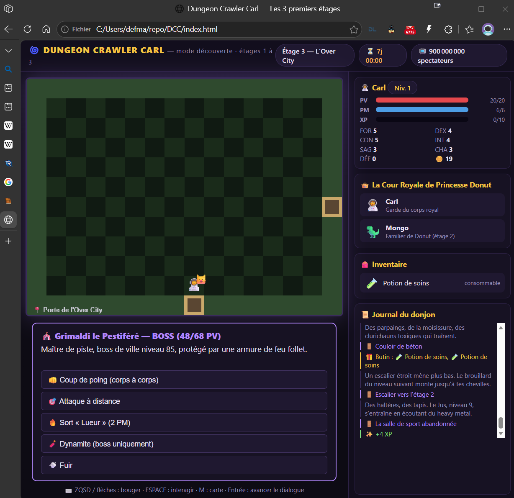

# 🌀 Dungeon Crawler Carl — Les 3 premiers étages (webgame)



Un **jeu web en mode découverte** inspiré de la série LitRPG de Matt Dinniman
(résumé basé sur [Wikipédia FR](https://fr.wikipedia.org/wiki/Dungeon_Crawler_Carl) et les wikis fans) :
explore les **étages 1 à 3** du donjon avec Carl et la Cour Royale de Princesse Donut.

## ▶️ Lancer le jeu
Aucune dépendance, aucun build : ouvre `index.html` dans un navigateur
(ou `python3 -m http.server` dans ce dossier puis http://localhost:8000).

## 🎮 Comment jouer
| Touche | Action |
|---|---|
| ZQSD / flèches | Se déplacer (les portes sont sur les bords de l'écran) |
| Espace | Interagir / déclencher la salle |
| Entrée | Avancer les dialogues |
| M | Carte de l'étage (salles explorées) |
| Clic sur un objet | L'utiliser (potions, parchemin de brume…) |

**Combats** : attaque au corps à corps, à distance, sort « Lueur » (2 PM), 🧨 dynamite (boss uniquement), ou fuite (impossible contre un boss — la salle se verrouille).

## 🗺️ Les 3 étages
1. **Étage 1 — Le Tutoriel** : Mordecai, le biscuit de Donut, les gobelins, et 3 boss de quartier — L'Accapareur, le Chef de guerre (chariot d'explosifs 🧨) et Le Juicer.
2. **Étage 2 — Le labyrinthe de parpaings** : clurichauns toxiques, la gnole Rev-Up, les dingos libérés, le boss Krakaren, et l'adoption de **Mongo** 🦖.
3. **Étage 3 — L'Over City** : le choix race **Primal** / classe **Anarchiste indemnisé**, le cirque de Grimaldi contre Tsarine Signet, la couronne 👑 de Donut… et la victoire.

## 📁 Structure
```
dcc-game/
├── index.html          # page du jeu
├── css/style.css       # interface (HUD façon LitRPG)
├── js/data.js          # données : 3 étages, salles, mobs, boss, dialogues
├── js/engine.js        # moteur : déplacement, combats, XP, scripts
├── js/main.js          # rendu canvas, entrées clavier, écrans
├── scripts/            # scripts de jeu narratifs (markdown, un par étage)
├── assets/ASSETS.md    # liste complète des assets à construire
└── test/smoke.test.js  # test de cohérence des données (node test/smoke.test.js)
```

## 🧪 Test
```bash
node test/smoke.test.js
```
Vérifie : graphe des salles connexe, scripts/objets/mobs/boss référencés existants, 3 étages, escaliers, boss, victoire.

## 🎨 Assets
Le jeu tourne en **100 % procédural** (émojis + canvas). La liste complète des sprites,
tilesets, musiques et illustrations à produire est dans [`assets/ASSETS.md`](assets/ASSETS.md).

---
*Hommage non officiel à l'univers de Matt Dinniman. « The show must go on! » 🎪*
